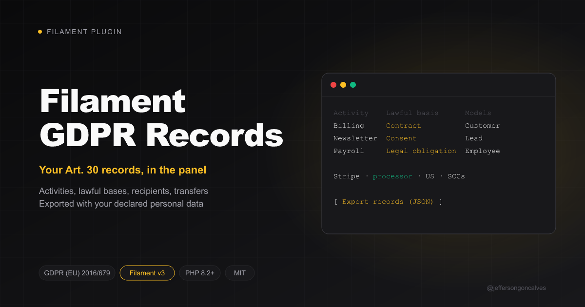

<div class="filament-hidden">



</div>

# Filament GDPR Records

[](https://packagist.org/packages/jeffersongoncalves/filament-gdpr-records)
[](https://github.com/jeffersongoncalves/filament-gdpr-records/actions?query=workflow%3Atests+branch%3A2.x)
[](https://github.com/jeffersongoncalves/filament-gdpr-records/actions?query=workflow%3A"Fix+PHP+code+styling"+branch%3A2.x)
[](https://packagist.org/packages/jeffersongoncalves/filament-gdpr-records)
[](LICENSE.md)

Manage the records of processing activities (GDPR Art. 30) of [laravel-gdpr-records](https://github.com/jeffersongoncalves/laravel-gdpr-records) from your Filament panel, and export them joined with the personal data you declared in your models.

## Features

- Processing activities: purpose, legal basis, data subjects, data categories, retention and security measures.
- Link activities to the models of `gdpr.models`: the personal data declared on them joins the record.
- Recipients (processor, controller, public authority) and transfers outside the EEA with their Chapter V mechanism.
- **Export records (JSON):** controller, EU representative, data protection officer and every activity, in one file.
- 19 languages.

## Compatibility

| Plugin Version                                                              | Filament |
|-----------------------------------------------------------------------------|----------|
| [1.x](https://github.com/jeffersongoncalves/filament-gdpr-records/tree/1.x) | 3.x      |
| [2.x](https://github.com/jeffersongoncalves/filament-gdpr-records/tree/2.x) | 4.x      |
| [3.x](https://github.com/jeffersongoncalves/filament-gdpr-records/tree/3.x) | 5.x      |

## Installation

You can install the package via composer:

```bash
composer require jeffersongoncalves/filament-gdpr-records:"^2.0"
php artisan vendor:publish --tag="gdpr-records-migrations"
php artisan migrate
```

The controller and the data protection officer are configured in laravel-gdpr-records' `gdpr-records` config (or the `GDPR_CONTROLLER_*` / `GDPR_DPO_*` env variables).

## Usage

```php
use JeffersonGoncalves\Filament\GdprRecords\GdprRecordsPlugin;

public function panel(Panel $panel): Panel
{
    return $panel
        ->plugins([
            GdprRecordsPlugin::make()
                ->navigationGroup('GDPR')             // default: no group
                ->navigationSort(5)
                ->navigationIcon('heroicon-o-clipboard-document-list')
                ->slug('processing-activities'),
        ]);
}
```

All fluent methods are optional.

> The resource has no authorization of its own: register it only on panels whose users maintain the records, or add a policy for `JeffersonGoncalves\GdprRecords\Models\ProcessingActivity`.

## Testing

```bash
composer test
```

## Changelog

Please see [CHANGELOG](CHANGELOG.md) for more information on what has changed recently.

## Contributing

Please see [CONTRIBUTING](.github/CONTRIBUTING.md) for details.

## Security Vulnerabilities

Please review [our security policy](../../security/policy) on how to report security vulnerabilities.

## Credits

- [Jefferson Gonçalves](https://github.com/jeffersongoncalves)
- [All Contributors](../../contributors)

## License

The MIT License (MIT). Please see [License File](LICENSE.md) for more information.
